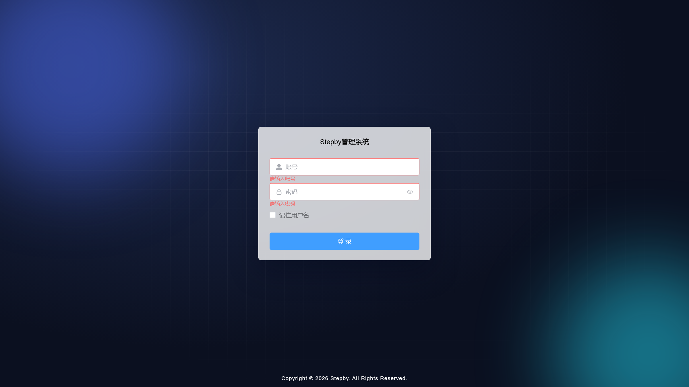
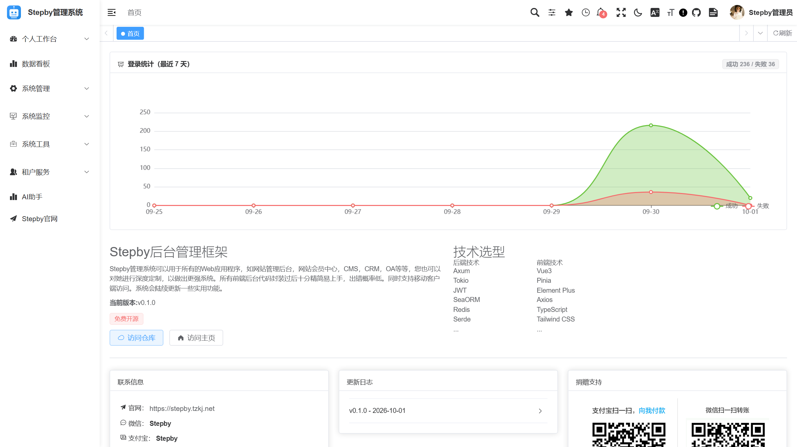
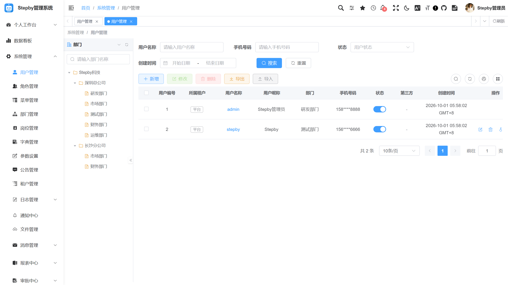
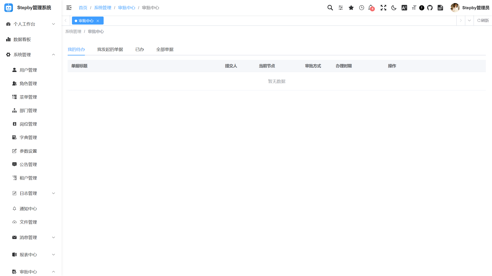
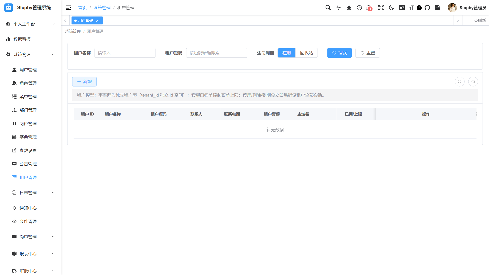
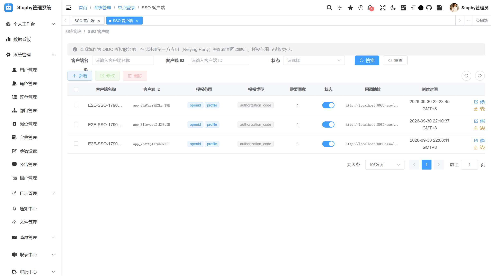
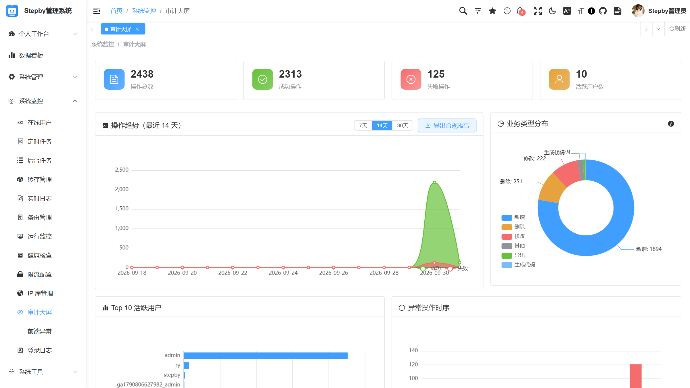

# Stepby Vue

[](https://github.com/stepbylabs/stepby-vue/actions/workflows/ci.yml)


Stepby 开源中后台管理系统前端，基于 **Vue 3 + TypeScript + Vite + Element Plus + TailwindCSS 4 + Pinia + Vue I18n** 构建。配套后端：[stepby-axum](https://github.com/stepbylabs/stepby-axum)（Rust / axum）。

## ✨ 功能特性

- **登录认证**：账号密码 + 验证码、TOTP 双因子、Passkey、SSO 客户端管理、首次登录强制改密
- **用户 / 角色 / 菜单**：RBAC 权限管理、动态菜单路由、数据权限规则、字段级权限矩阵
- **多租户**：租户管理、套餐能力位、租户域名
- **工作流审批**：流程定义可视化、加签/减签/委派、审批待办与图驱动单据
- **AI 助手**：LLM 双源配置页、AI 问数（受控 NL2SQL + 问数历史）
- **报表中心**：受控数据集、可视化大屏、报表订阅推送
- **审计合规**：操作日志差异、审计数据可视化大屏、审计归档（链完整性校验 + 下载）
- **运维面板**：告警规则、webhook 事件目录、限流管理、消息渠道（邮件/短信/IM 群机器人）
- **国际化**：中文 / 英文（Vue I18n，菜单文案由后端 i18n key 驱动）
- **移动端响应式 + PWA**：可安装主屏、离线缓存、响应式三档布局
- **多主题**：亮 / 暗模式、侧边栏三档主题、主题编辑器
- **代码生成器配套**：与后端代码生成器配套的前端页面模板

## 技术栈

- [Vue 3](https://v3.cn.vuejs.org) - 渐进式前端框架
- [Element Plus](https://element-plus.org/zh-CN) - UI 组件库
- [TypeScript](https://www.typescriptlang.org) - 类型安全
- [Pinia](https://pinia.vuejs.org/zh) - 状态管理
- [Vue Router 4](https://router.vuejs.org/zh) - 路由管理
- [Axios](https://axios-http.com/zh) - HTTP 请求库
- [Vite](https://cn.vitejs.dev) - 构建工具
- [Tailwind CSS 4](https://tailwindcss.com) - 原子化 CSS 框架
- [Vue I18n](https://vue-i18n.intlify.dev/) - 国际化

## 📸 预览

**登录页**



**用户管理**



**租户管理**



**审计大屏**



## 🚀 快速开始

```bash
# 环境要求：Node 20+（npm / pnpm 均可）
npm install

# 启动开发服务（默认端口 5173）
npm run dev

# 构建生产包
npm run build:prod

# 预览生产构建
npm run preview

# 类型检查
npm run typecheck
```

开发模式下前端通过 Vite 代理将 API 请求转发至后端 `http://localhost:8080`（见 `vite.config.ts`）。

默认账号：`admin` / `admin123`（首次登录强制修改密码）。

## 🧪 测试

```bash
npm run typecheck    # vue-tsc 类型检查
npm run test:run     # vitest 单测：100 个文件 / 1253 例
npm run lint         # eslint
```

E2E 测试基于 Playwright，共 **144 个功能 / 1260 项断言**（单套件全量），入口为 `tests/e2e/main.mjs`。
另有补充深测 `tests/e2e/deep-e2e.mjs`（88 个模块 / 1231 项断言）与全站无障碍检查 `tests/e2e/a11y-full.mjs`
（56 条路由 / 560 检查）。运行前需：

1. 后端启动在 `http://localhost:8080`（零配置单文件即可）
2. 前端启动在 `http://localhost:5173`（或通过 `FRONTEND_URL` 环境变量指定）
3. 关闭验证码：参数 `sys.account.captchaEnabled = false`

完整跑批口径、分段方式与判据基线见 [`tests/e2e/RUN-RECIPE.md`](tests/e2e/RUN-RECIPE.md)。

## 🚀 预编译产物

每个版本在 [Releases](https://github.com/stepbylabs/stepby-vue/releases) 附 `stepby-frontend-v<版本>.tar.gz`
（解压得到 `dist/`，即 `VITE_APP_BASE_API=/prod-api` 的反代档，直接交给 Nginx/静态托管）与 `checksums.txt`。

需要**同源直出**（不带 `/prod-api` 前缀）的形态时，用 `npm run build:embedded` 构建后交给后端嵌入，
或参考后端仓库的预编译单文件包——前端资源已编进 `stepby-axum` 二进制，解压即可运行。

产物由 `.github/workflows/release.yml` 在推送 `v*` 标签时构建；Actions 额度不可用时，可在本机用
`scripts/package-release.ps1 -Release -Tag v<版本>` 产出同一资产集（命名与结构逐字段一致），再用
`gh release upload` 挂到 Release。

## 📄 License

[MIT](LICENSE) © 2026 Stepby

## 📦 版本

变更历史见 [CHANGELOG.md](CHANGELOG.md)。当前版本 **v0.3.0**（2026-10-20）。
